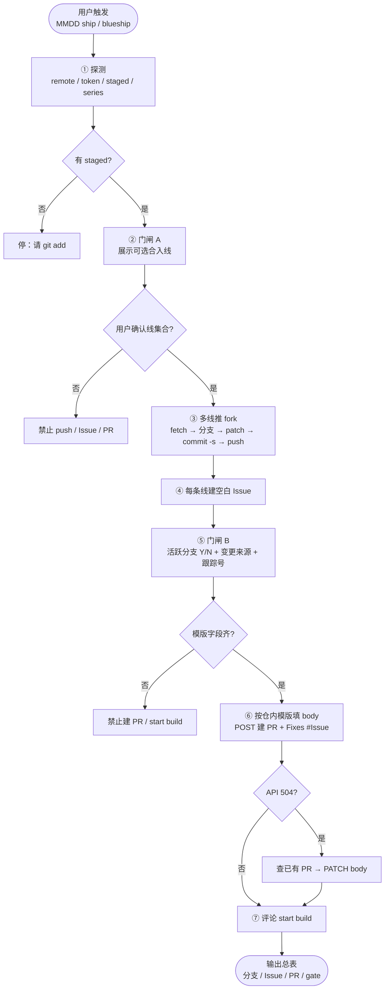
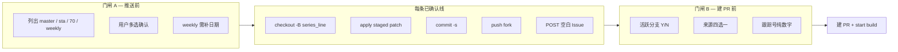
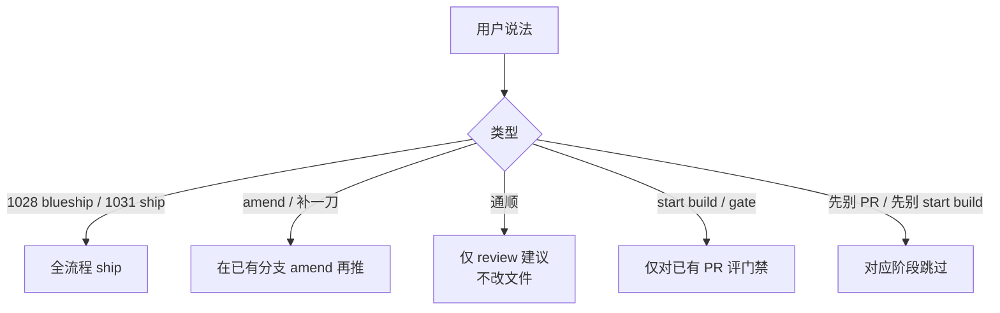

# blueship

蓝区文档 **多线合入** Cursor Skill：以 **Skill 主编排**（`git` + GitCode API），`cli/` 仅为可选加速。

完整链路：

**staged → 门闸 A 选线 → 多线推 fork → 建 Issue → 门闸 B 填模版 → 建 PR → 评论 `start build`**

编排细节以 [`SKILL.md`](./SKILL.md) 为准；API / 白名单速查见 [`reference.md`](./reference.md)。

---

## 流程图

### 端到端主流程



### 门闸与分支



### 触发词分流



---

## 白名单主仓

- `openharmony/docs`
- `openharmony/interface_sdk-js`
- `openharmony/interface_sdk_c`
- `HarmonyOS_Samples/guide-snippets`

fork = 同 repo 名、owner **不在**白名单（只推 fork，不推 upstream 主仓分支）。

---

## 依赖

- `git` + Cursor（装好本 Skill）
- 双 remote：白名单 **upstream** + 自己的 **fork**
- GitCode Token（Issue / PR / start build）：

```bash
git config --global gitcode.token <YOUR_TOKEN>
# 或
export GITCODE_TOKEN=<YOUR_TOKEN>
```

---

## 安装与用法（Skill）

```bash
# 1. 安装 Skill（一次）
# 解压本包后：
ln -s /path/to/blueship ~/.cursor/skills/blueship

# 2. 目标仓准备（一次）：双 remote + 可选 .blueship.json
git remote add hearn git@gitcode.com:<you>/docs.git   # 示例

# 3. 改文档并 stage
git add path/to/doc.md

# 4. 在 Cursor 对话里说，例如：
#    1031 ship
# Agent 会：探测 → 门闸 A 选线 → 推 fork → 建 Issue
#          → 门闸 B 填模版 → 建 PR（Fixes #Issue）→ start build
```

| 说法 | 行为 |
|------|------|
| `blueship` / `/blueship` | 全流程 |
| `1028 blueship` / `1031 ship` | 指定 series 全流程 |
| `通顺` | 仅 review |
| `amend` / `补一刀` | 强制 amend |
| `start build` / `gate` | 仅对已有 PR 评门禁 |
| `先别 PR` / `先别 start build` | 对应阶段跳过 |

---

## 配置示例 `.blueship.json`

无则 Agent 可按 remote **直接写入**（不必死磕交互式 `init`）：

```json
{
  "upstream": "origin",
  "fork": "hearn",
  "upstream_repo": "openharmony/docs",
  "lines": {
    "master": "master",
    "sta": "OpenHarmony_feature_sta_20260331",
    "70": "OpenHarmony-7.0-Release",
    "weekly": "weekly_{date}"
  },
  "create_issue": true,
  "create_pr": true,
  "start_build": true
}
```

`docs` 仓默认线映射：

| 线名 | 主仓分支 | 本地/fork 分支名 |
|------|----------|------------------|
| `master` | `master` | `{series}_master` |
| `sta` | `OpenHarmony_feature_sta_20260331` | `{series}_sta` |
| `70` | `OpenHarmony-7.0-Release` | `{series}_70` |
| `weekly` | `weekly_{date}` | `{series}_701` |

---

## 可选：CLI

预编译在 `cli/dist/`（多平台）。适合本机脚本；**建 PR / 填模版 / 门闸仍以 Skill 为准**。CLI 失败或行为怪异时忽略 CLI，按 `SKILL.md` 直做。

```bash
chmod +x cli/dist/blueship-darwin-arm64
sudo cp cli/dist/blueship-darwin-arm64 /usr/local/bin/blueship
blueship status --json
# 仅推 fork + Issue（不含按模版建 PR）：
blueship ship --series 1028 --lines master,sta,70
blueship gate --series 1028
```

本机编译：`cd cli && ./build.sh`。

| 命令 | 作用 |
|------|------|
| `blueship init` | 写入 `.blueship.json` |
| `blueship status [--json]` | 探测配置与下一步建议 |
| `blueship ship --series NAME --lines a,b,c` | 应用 staged、推 fork；默认可建空白 Issue |
| `blueship ship --amend …` | amend + `--force-with-lease` |
| `blueship gate --series NAME` / `--mr N,N` | 评论 `start build` |
| `blueship version` | 版本号 |

退出码：`0` 成功 · `2` 缺依赖/配置 · `3` 需用户补充或确认。

---

## 职责边界

| 做 | 不做 |
|----|------|
| 检查双 remote + token | 不打印 token |
| review 只建议，确认后才改文 | 缺 remote/token 不硬推 |
| 多线推 **fork** | 不推 upstream 主仓分支 |
| 按仓内模版建 PR + 关联 Issue | 不把无关改动夹进同一 PR |
| 评 `start build` | 未过门闸 A/B 不建 PR |

---

## 开发

```bash
cd cli
go build -o dist/blueship .
./build.sh   # 交叉编译多平台
```
